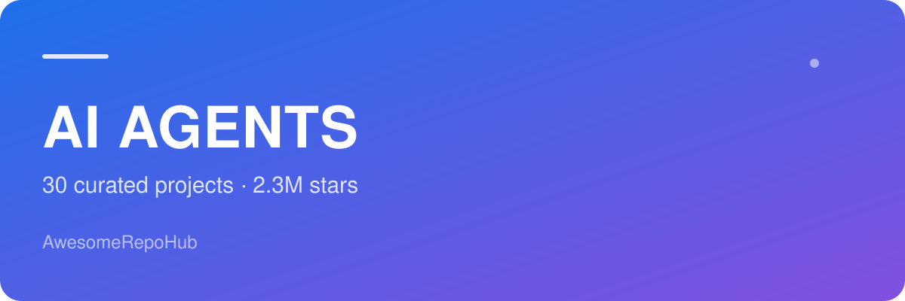
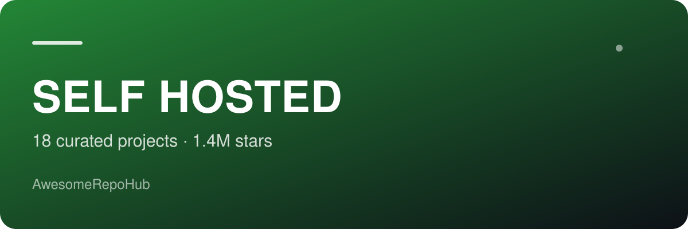
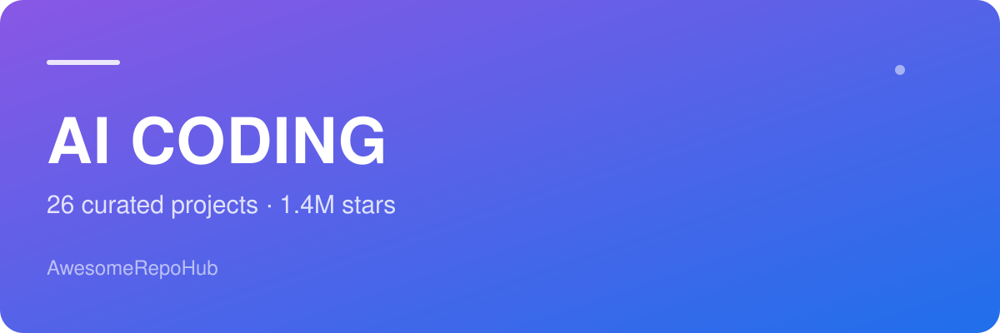
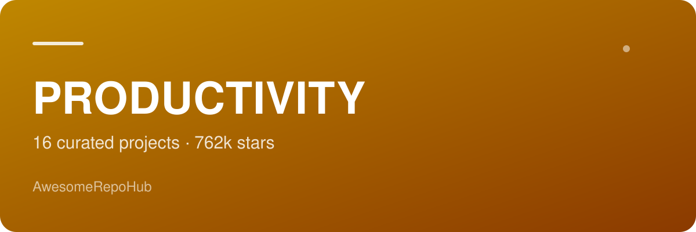
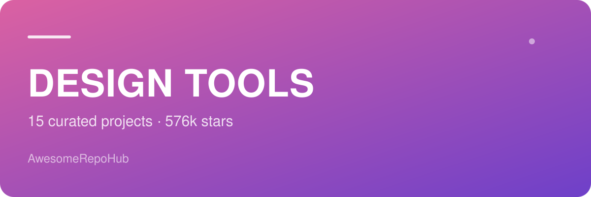
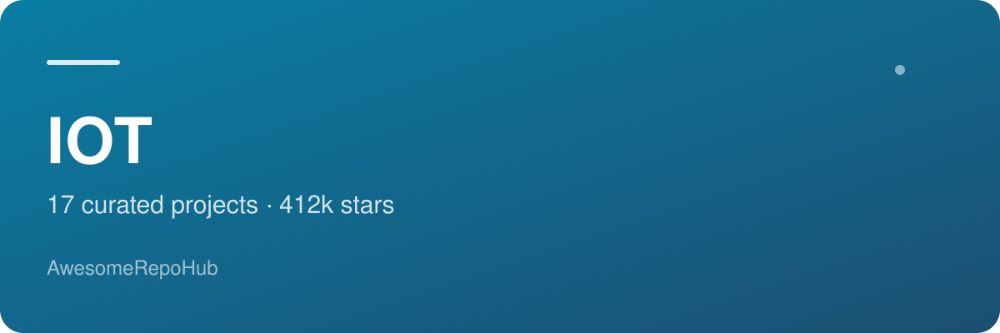
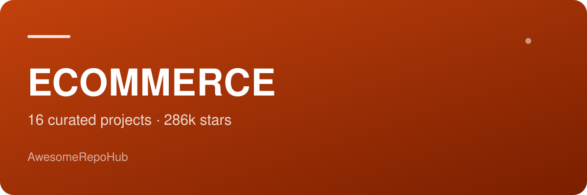

<h3>AwesomeRepoHub</h3>
<h1>Awesome Index</h1>

Curated open-source lists by industry and topic — every entry is real, licensed and still maintained.

  

<a href="README.md">中文</a> &#183; <a href="CONTRIBUTING.md">Contributing</a>

> **7 collections, 117 projects, 5.9M stars.** Numbers come from the GitHub API; generated 2026-10-24.

## Collections

<table>
<tr>
<td width="340" valign="top">

</td>
<td valign="top">

<a href="https://github.com/AwesomeRepoHub/awesome-ai-agents"><b>Awesome AI Agents</b></a> <code>awesome-ai-agents</code>

Agent frameworks and ready-to-use agents that still ship — grouped by what you are actually trying to do

19 projects &#183; 1.5M stars &#183; <a href="https://github.com/AwesomeRepoHub/awesome-ai-agents/blob/main/README.md">Chinese</a> / <a href="https://github.com/AwesomeRepoHub/awesome-ai-agents/blob/main/README.en.md">English</a>

Start with: <a href="https://github.com/langchain-ai/langchain">LangChain</a> &#183; <a href="https://github.com/crewAIInc/crewAI">CrewAI</a> &#183; <a href="https://github.com/browser-use/browser-use">Browser Use</a>

</td>
</tr>
</table>

<table>
<tr>
<td width="340" valign="top">

</td>
<td valign="top">

<a href="https://github.com/AwesomeRepoHub/awesome-self-hosted"><b>Awesome Self-Hosted</b></a> <code>awesome-self-hosted</code>

Take your data back — photos, files, media, automation and deploy panels, with an honest note on how heavy each one is

18 projects &#183; 1.4M stars &#183; <a href="https://github.com/AwesomeRepoHub/awesome-self-hosted/blob/main/README.md">Chinese</a> / <a href="https://github.com/AwesomeRepoHub/awesome-self-hosted/blob/main/README.en.md">English</a>

Start with: <a href="https://github.com/immich-app/immich">Immich</a> &#183; <a href="https://github.com/nextcloud/server">Nextcloud</a> &#183; <a href="https://github.com/coollabsio/coolify">Coolify</a>

</td>
</tr>
</table>

<table>
<tr>
<td width="340" valign="top">

</td>
<td valign="top">

<a href="https://github.com/AwesomeRepoHub/awesome-ai-coding"><b>Awesome AI Coding</b></a> <code>awesome-ai-coding</code>

AI tools that actually edit your codebase — terminal agents, IDE assistants, context tooling and specs

16 projects &#183; 915k stars &#183; <a href="https://github.com/AwesomeRepoHub/awesome-ai-coding/blob/main/README.md">Chinese</a> / <a href="https://github.com/AwesomeRepoHub/awesome-ai-coding/blob/main/README.en.md">English</a>

Start with: <a href="https://github.com/cline/cline">Cline</a> &#183; <a href="https://github.com/All-Hands-AI/OpenHands">OpenHands</a> &#183; <a href="https://github.com/Aider-AI/aider">Aider</a>

</td>
</tr>
</table>

<table>
<tr>
<td width="340" valign="top">

</td>
<td valign="top">

<a href="https://github.com/AwesomeRepoHub/awesome-productivity"><b>Awesome Productivity</b></a> <code>awesome-productivity</code>

Notes, tasks, whiteboards and small utilities that survive daily use — not the flavor of the month

16 projects &#183; 762k stars &#183; <a href="https://github.com/AwesomeRepoHub/awesome-productivity/blob/main/README.md">Chinese</a> / <a href="https://github.com/AwesomeRepoHub/awesome-productivity/blob/main/README.en.md">English</a>

Start with: <a href="https://github.com/AppFlowy-IO/AppFlowy">AppFlowy</a> &#183; <a href="https://github.com/logseq/logseq">Logseq</a> &#183; <a href="https://github.com/makeplane/plane">Plane</a>

</td>
</tr>
</table>

<table>
<tr>
<td width="340" valign="top">

</td>
<td valign="top">

<a href="https://github.com/AwesomeRepoHub/awesome-design-tools"><b>Awesome Design Tools</b></a> <code>awesome-design-tools</code>

From canvas to production CSS — open-source design tools, component libraries and design systems, ordered by workflow

15 projects &#183; 576k stars &#183; <a href="https://github.com/AwesomeRepoHub/awesome-design-tools/blob/main/README.md">Chinese</a> / <a href="https://github.com/AwesomeRepoHub/awesome-design-tools/blob/main/README.en.md">English</a>

Start with: <a href="https://github.com/penpot/penpot">Penpot</a> &#183; <a href="https://github.com/mui/material-ui">Material UI</a> &#183; <a href="https://github.com/tailwindlabs/tailwindcss">Tailwind CSS</a>

</td>
</tr>
</table>

<table>
<tr>
<td width="340" valign="top">

</td>
<td valign="top">

<a href="https://github.com/AwesomeRepoHub/awesome-iot"><b>Awesome IoT</b></a> <code>awesome-iot</code>

Firmware to platform, dev boards to device UIs — embedded and IoT projects you can actually flash today

17 projects &#183; 412k stars &#183; <a href="https://github.com/AwesomeRepoHub/awesome-iot/blob/main/README.md">Chinese</a> / <a href="https://github.com/AwesomeRepoHub/awesome-iot/blob/main/README.en.md">English</a>

Start with: <a href="https://github.com/home-assistant/core">Home Assistant</a> &#183; <a href="https://github.com/esphome/esphome">ESPHome</a> &#183; <a href="https://github.com/emqx/emqx">EMQX</a>

</td>
</tr>
</table>

<table>
<tr>
<td width="340" valign="top">

</td>
<td valign="top">

<a href="https://github.com/AwesomeRepoHub/awesome-ecommerce"><b>Awesome E-commerce</b></a> <code>awesome-ecommerce</code>

Everything needed to run your own store — commerce platforms, headless frontends, payments and back office

16 projects &#183; 286k stars &#183; <a href="https://github.com/AwesomeRepoHub/awesome-ecommerce/blob/main/README.md">Chinese</a> / <a href="https://github.com/AwesomeRepoHub/awesome-ecommerce/blob/main/README.en.md">English</a>

Start with: <a href="https://github.com/medusajs/medusa">Medusa</a> &#183; <a href="https://github.com/woocommerce/woocommerce">WooCommerce</a> &#183; <a href="https://github.com/bagisto/bagisto">Bagisto</a>

</td>
</tr>
</table>

## How to use

1. Each card above is one collection — click the banner or title.
2. Inside, tables are sorted by stars with license in the last column, plus a 30-second pick table.
3. Chinese notes are our selection judgement; English notes keep each project's own wording.

## License

Content is MIT licensed. Each project keeps its own license.

---

Generated by a script from the curated data and the GitHub API; stars and dates refresh on every build.
